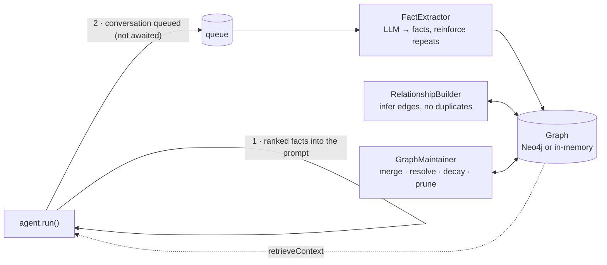

<div align="center">

# 🏹 SAGU

**The TypeScript agent SDK whose memory maintains itself.**

Build agents that remember users across sessions, without building a memory pipeline.<br>
A readable agent loop, any model vendor, and a knowledge graph kept clean by three background processes.

[](https://www.npmjs.com/package/sagu-sdk)
[](https://nodejs.org)
[](https://www.typescriptlang.org)
[](LICENSE)

[**Docs**](https://vectorbytes.github.io/SaGuDocs/) · [**Quickstart**](https://vectorbytes.github.io/SaGuDocs/docs/getting-started/quickstart/) · [**npm**](https://www.npmjs.com/package/sagu-sdk) · [**Examples**](examples)

</div>

```bash
npm install sagu-sdk zod@3
```

---

## The problem: agents forget, and remembering is a project

Every assistant that talks to the same people twice runs into the same wall. The agent forgot what the user said last week. The usual fixes each break in their own way:

| Approach | What goes wrong |
|---|---|
| **Replay chat history** | The prompt grows every turn, costs climb, and it's still limited to one conversation. |
| **Vector memory** (embed and search old messages) | It retrieves *similar text*, not *current truth*. "I moved to Berlin" doesn't cancel "I live in Paris"; both come back. |
| **Build your own extraction pipeline** | Weeks of work: an LLM extraction prompt, deduplication, conflict handling, decay, retries, and it must never slow down the user's request. |

Meanwhile, most agent frameworks hide their execution loop under layers of abstraction. When something goes wrong at 3 a.m., you're debugging a framework instead of your agent.

## The solution

SAGU gives you an agent runtime you can read in one sitting, plus **long-term memory as a knowledge graph that maintains itself**:

```typescript
import { Agent, LongTermMemory, Neo4jGraphMemoryStore, anthropic } from "sagu-sdk";

const memory = new LongTermMemory({
  store: new Neo4jGraphMemoryStore({ uri: "bolt://localhost:7687" }),
  model: anthropic(), // the model that extracts facts in the background
});
memory.start();

const assistant = new Agent({ name: "Assistant", instructions: "Help the user.", model: anthropic() });

await assistant.run("I just moved to Berlin, and I'm leading the Atlas project now.", { longTermMemory: memory });
// Returns immediately. Then, in the background (say the graph already knew
// "User LIVES_IN Paris" and "Atlas USES Neo4j"):
//   fact_added             User LIVES_IN Berlin
//   fact_added             User WORKS_ON Atlas
//   relationship_inferred  User USES Neo4j          ← WORKS_ON Atlas + Atlas USES Neo4j
//   conflict_resolved      kept LIVES_IN Berlin, removed Paris

await assistant.run("Plan my week.", { longTermMemory: memory });
// A new session with no chat history. The prompt already knows where the user lives and what they work on.
```

The run never waits for memory work. Three independent background processes keep the graph accurate:



| Process | Problem it solves | What it does |
|---|---|---|
| **FactExtractor** | Conversations contain facts nobody saved | An LLM turns each finished conversation into `(subject, predicate, object)` facts with confidence. Repeated facts are reinforced, not duplicated. |
| **RelationshipBuilder** | Facts imply relationships nobody stated | Adds reverse edges for symmetric relations (`KNOWS`) and chain rules (`WORKS_ON` + `USES` ⇒ `USES`). Never creates self-loops or duplicates, and never overwrites a stated fact. |
| **GraphMaintainer** | Graphs rot: duplicates, contradictions, stale facts | Merges `TypeScript` / `type-script`, keeps only the newest `LIVES_IN`, and prunes facts whose confidence has decayed with age. |

Every change is an event (`graph_updated`) and a trace span. Failures are retried, and a memory outage never fails a run.

## Who it's for

**TypeScript and Node.js developers building assistants that see the same users again**: support agents, internal copilots, coaching or tutoring bots, sales assistants. Anything where "remember me" is the feature, and where you'd rather not spend a month building memory infrastructure.

## Why SAGU and not the alternatives

| | Chat history | Vector memory | DIY pipeline | **SAGU** |
|---|:-:|:-:|:-:|:-:|
| Works across sessions and agents | ✗ | ✓ | ✓ | ✓ |
| New facts override old ones | ✗ | ✗ | if you build it | ✓ conflict resolution |
| Deduplicates entities | ✗ | ✗ | if you build it | ✓ merge |
| Old, unconfirmed facts fade | ✗ | ✗ | if you build it | ✓ confidence decay |
| Infers unstated relationships | ✗ | ✗ | if you build it | ✓ inference rules |
| Adds no latency to the user's request | ✗ grows the prompt | search on every call | depends | ✓ queued, background |
| Inspectable (why does it know this?) | ✓ | ✗ opaque vectors | depends | ✓ every fact has `source`, `confidence`, timestamps |
| Setup time | none | moderate | weeks | `npm install` |

And the runtime around it is built to be trusted:

- **Readable core.** The whole agent loop is one file, [`src/runner.ts`](src/runner.ts). There's no hidden orchestration layer to reverse-engineer.
- **Predictable results.** `agent.run()` doesn't throw on expected failures: guardrail blocks, `maxTurns`, schema repair exhausted, provider errors. You get `{ success: false, error }` with a typed error code. Configuration mistakes still throw immediately.
- **Any model vendor.** Adapters for Anthropic, OpenAI and Gemini behind one small interface, plus `fallback(a, b, c)` for failover. Switching vendors is a one-line change.
- **Testable offline.** `mock([...])` scripts model turns deterministically. All 89 of SAGU's own tests run with no network and no API keys.
- **Safe by default.** Input, output and tool guardrails. Risky tools need explicit approval and are denied if there's no handler. API keys are redacted from every trace.

## Everything in the box

| Capability | API |
|---|---|
| Agent loop with tools, Zod-validated args, timeouts, `maxTurns` | `new Agent()`, `defineTool()`, `agent.run()` |
| Multi-agent handoffs with loop protection | `handoffs: [...]`, `maxHandoffs` |
| Input / output / tool guardrails, human approval | `inputGuardrails`, `toolGuardrails`, `requiresApproval`, `onApprovalRequired` |
| Typed structured output with automatic repair | `new Agent<T>({ outputSchema })`, `maxRepairAttempts` |
| Streaming events | `agent.stream()`: `tool_start`, `tool_end`, `handoff`, `guardrail_triggered`, `memory_updated`, … |
| Session history | `InMemorySession`, `FileSession`, `SqliteSession` (built-in `node:sqlite`) |
| Long-term graph memory + 3 background processes | `LongTermMemory`, `Neo4jGraphMemoryStore`, `FactExtractor`, `RelationshipBuilder`, `GraphMaintainer` |
| Tracing with secret redaction | `ConsoleExporter`, `JSONFileExporter`, custom `TraceExporter` |
| Retry, timeout, provider fallback | `withRetry`, `withTimeout`, `fallback()` |

## Quickstart (no API key needed)

```typescript
import { z } from "zod";
import { Agent, defineTool, mock } from "sagu-sdk";

const calculatorTool = defineTool({
  name: "calculate",
  description: "Evaluate math expression",
  input: z.object({
    expression: z.string().describe("Expression like '45 * 12'"),
  }),
  execute: async ({ expression }) => {
    return { result: 540 };
  },
});

const agent = new Agent({
  name: "MathBot",
  instructions: "Answer user queries with tools.",
  model: mock([
    {
      toolCalls: [{ id: "call_1", name: "calculate", arguments: { expression: "45 * 12" } }],
    },
    "45 multiplied by 12 is 540.",
  ]),
  tools: [calculatorTool],
});

const result = await agent.run("What is 45 * 12?");

if (result.success) {
  console.log("Answer:", result.output); // "45 multiplied by 12 is 540."
  console.log("Tokens used:", result.usage.totalTokens);
} else {
  console.error("Execution failed:", result.error.message);
}
```

Save it as `app.ts` in a project with `"type": "module"` and run `node app.ts` (Node 22.18+), or use `npx tsx app.ts`. To use a real model, swap `mock([...])` for `anthropic()`, `openai()` or `gemini()` and set the matching API key. → [Full quickstart](https://vectorbytes.github.io/SaGuDocs/docs/getting-started/quickstart/)

## A few more capabilities

<details>
<summary><b>Multi-agent handoffs</b></summary>

```typescript
import { z } from "zod";
import { Agent, anthropic, defineTool } from "sagu-sdk";

const issueRefund = defineTool({
  name: "issue_refund",
  description: "Issue a refund for an invoice.",
  input: z.object({ invoiceId: z.string(), amount: z.number() }),
  execute: async ({ invoiceId, amount }) => ({ status: "APPROVED", invoiceId, amount }),
});

const billing = new Agent({ name: "BillingSpecialist", instructions: "Process refunds.", model: anthropic(), tools: [issueRefund] });
const triage = new Agent({ name: "Triage", instructions: "Route the customer to a specialist.", model: anthropic(), handoffs: [billing] });

const result = await triage.run("I need a refund for INV-2024.");
// Triage calls transfer_to_billingspecialist; BillingSpecialist finishes the run with the full history.
```
</details>

<details>
<summary><b>Guardrails and human approval</b></summary>

```typescript
import { createInterface } from "node:readline/promises";
import { z } from "zod";
import { Agent, anthropic, createRegexInputGuardrail, createRegexOutputGuardrail, defineTool } from "sagu-sdk";

const rebootServer = defineTool({
  name: "reboot_server",
  description: "Reboot a server by ID.",
  input: z.object({ serverId: z.string() }),
  requiresApproval: true, // denied unless onApprovalRequired returns true
  execute: async ({ serverId }) => ({ serverId, status: "REBOOTED" }),
});

const agent = new Agent({
  name: "SecureOps",
  instructions: "You manage servers.",
  model: anthropic(),
  tools: [rebootServer],
  inputGuardrails: [createRegexInputGuardrail({ pattern: /ignore previous instructions/i, reason: "Prompt injection attempt" })],
  outputGuardrails: [createRegexOutputGuardrail({ pattern: /sk-[a-zA-Z0-9_-]{20,}/g, replaceWith: "[redacted]" })],
});

const rl = createInterface({ input: process.stdin, output: process.stdout });
const result = await agent.run("Reboot prod-1", {
  onApprovalRequired: async (call) => (await rl.question(`Allow ${call.name}? (y/N) `)).trim() === "y",
});
rl.close();
```
</details>

<details>
<summary><b>Typed structured output with self-repair</b></summary>

```typescript
import { z } from "zod";
import { Agent, openai } from "sagu-sdk";

const Profile = z.object({ name: z.string(), age: z.number().int(), interests: z.array(z.string()) });

const extractor = new Agent<z.infer<typeof Profile>>({
  name: "ProfileExtractor",
  instructions: "Extract the user profile.",
  model: openai(),
  outputSchema: Profile,
  maxRepairAttempts: 2, // invalid JSON → validation errors sent back to the model → retry
});

const result = await extractor.run("Alice is 30 and loves TypeScript and Neo4j.");
if (result.success) console.log(result.output.interests); // typed as string[]
```
</details>

<details>
<summary><b>Streaming events</b></summary>

```typescript
import { Agent, mock } from "sagu-sdk";

const agent = new Agent({ name: "Explainer", instructions: "Explain clearly.", model: mock(["Qubits can be 0 and 1 at once."]) });

for await (const event of agent.stream("Explain quantum computing")) {
  if (event.type === "text_delta") process.stdout.write(event.text);
  else if (event.type === "tool_start") console.log(`\n→ ${event.name}`);
  else if (event.type === "run_completed") console.log(`\nDone in ${event.turns} turns`);
}
```

The built-in Anthropic, OpenAI and Gemini adapters currently deliver each response as a single `text_delta`. Token-by-token streaming is on the roadmap.
</details>

<details>
<summary><b>Provider fallback</b></summary>

```typescript
import { Agent, anthropic, fallback, gemini, openai } from "sagu-sdk";

const agent = new Agent({
  name: "HighAvailability",
  instructions: "Assist the user.",
  model: fallback(anthropic(), openai(), gemini()), // tried in order; any error moves to the next
});
```
</details>

## Proof it works

- **[On npm](https://www.npmjs.com/package/sagu-sdk).** Verified by installing into a clean project and running on Node.js 22.13 and 25.
- **89 tests** with Node's built-in test runner, including an end-to-end **integration test against a real Neo4j 5** database (run with `NEO4J_URI` set).
- **5 runnable examples**, all offline. [`examples/05-background-graph-memory`](examples/05-background-graph-memory/index.ts) shows the three processes working live:

```text
[run 1] returned in 3ms; extraction queued: 1
  ⟳ [fact_extractor] fact_added: User LIVES_IN Paris
  ⟳ [fact_extractor] fact_added: Atlas USES neo4j
[run 2] returned in 1ms
  ⟳ [fact_extractor] fact_reinforced: Atlas USES Neo4j
  ⟳ [relationship_builder] relationship_inferred (works_on_uses): User USES Neo4j @ 0.93
  ⟳ [graph_maintainer] entities_merged: "type-script" → "TypeScript"
  ⟳ [graph_maintainer] conflict_resolved: kept LIVES_IN Berlin, removed Paris
```

- **[Hosted documentation](https://vectorbytes.github.io/SaGuDocs/).** 57 pages with diagrams, guides for every feature, an API reference, and an interactive demo of the agent loop.

## Roadmap

Honest about what's next:

- Token-by-token streaming in the real provider adapters
- Semantic (embedding) retrieval alongside keyword retrieval
- A durable extraction queue and multi-instance coordination for the background processes
- More providers (OpenAI-compatible endpoints, local models)

Full list: [Known limitations](https://vectorbytes.github.io/SaGuDocs/docs/contributing/limitations/).

## Develop

```bash
git clone https://github.com/VeCtORbytes/SaGuSDK.git && cd SaGuSDK && npm install
npm test                 # 89 tests, no network or API keys
npm run typecheck
node examples/05-background-graph-memory/index.ts
```

Project layout, architecture and contribution guide: [docs → Contributing](https://vectorbytes.github.io/SaGuDocs/docs/contributing/).

<details>
<summary><b>For cohort evaluators: requirement → implementation map</b></summary>

| Rubric area | Marks | Where |
|---|---|---|
| Agent runtime | 15 | [`src/runner.ts`](src/runner.ts): one loop for `run()` and `stream()`, `maxTurns`, abort signal, return-not-throw |
| Tools and guardrails | 10 | [`src/tool.ts`](src/tool.ts), [`src/guardrails.ts`](src/guardrails.ts): Zod validation, async tools, timeouts, input/output/tool guardrails, approval |
| Handoffs and multi-agent flow | 10 | [`src/handoff.ts`](src/handoff.ts): `transfer_to_*` tools, shared history, `maxHandoffs`, `handoff` events and spans |
| Memory and sessions | 10 | [`src/memory/`](src/memory): in-memory, file and SQLite sessions; config / run state / session / long-term memory kept separate |
| Graph database integration | 10 | [`neo4jGraphMemory.ts`](src/memory/neo4jGraphMemory.ts): entities and typed relations with confidence, mentions, source, timestamps; retrieval injected into prompts |
| Three background graph processes | 15 | [`graphProcesses.ts`](src/memory/graphProcesses.ts): extractor, relationship builder, maintainer on independent timers, with retries, events, traces |
| Structured output and streaming | 10 | [`src/structuredOutput.ts`](src/structuredOutput.ts), [`src/events.ts`](src/events.ts): schema repair, `Agent<T>`, async-iterator events |
| Reliability and tracing | 10 | [`src/reliability.ts`](src/reliability.ts), [`src/trace.ts`](src/trace.ts): retry, timeout, fallback, span trees with memory/graph spans, secret redaction |
| Developer experience | 10 | npm package with types, `mock()` for offline tests, clear `ConfigurationError` messages |
| Documentation and examples | 10 | [Hosted docs](https://vectorbytes.github.io/SaGuDocs/), 5 examples |
| Product thinking and pitch | 10 | This README |
</details>

---

<div align="center">

**SAGU** comes from **Sa**rthak **Gu**pta, and from *Sarthi*, the charioteer who steers.<br>
Built by [Sarthak Gupta](https://github.com/VeCtORbytes) · MIT License

</div>
